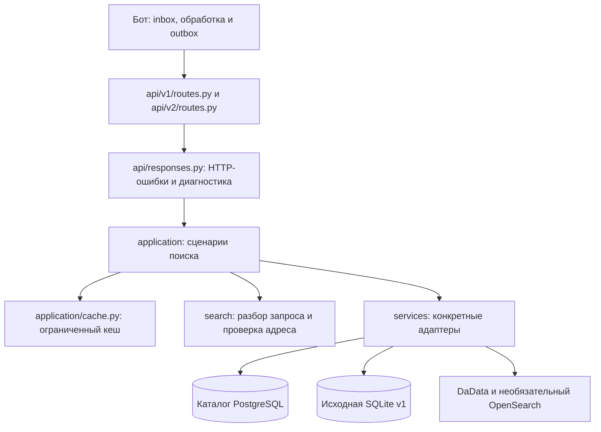

# Архитектура dev

HTTP-маршруты, сценарии поиска и доступ к данным разделены. Существующий v1 сохраняет алгоритм
и исходную SQLite; v2 использует каталог PostgreSQL и проверенный fallback v1.

## Где что находится

| Пакет | Ответственность |
| --- | --- |
| `src/api/v1`, `src/api/v2` | Параметры и пути HTTP, вызов сценария. Без SQL и алгоритмов поиска. |
| `src/api/responses.py` | Преобразование ошибок сценария в 404/503 и обёртка диагностики. |
| `src/api/app.py` | Сборка приложения, подключение роутеров, OpenAPI и завершение читателей каталога. |
| `src/application/source_search.py` | Сценарии совместимого текстового и геопоиска v1. |
| `src/application/search.py` | Сценарии v2: кеш, поиск, проверенный fallback, геопоиск и чтение выбранного дома. Без Litestar и HTTP-статусов. |
| `src/search` | Разбор адреса, ограничения дома/улицы, сопоставление кандидатов и читатели каталога. |
| `src/search/source_matching.py` | Неизменённые правила сопоставления v1, отделённые от SQLite. |
| `src/services` | Адаптеры исходной базы, sidecar-индекса, DaData и OpenSearch; создание конкретного читателя каталога. |
| `src/config.py` | Общая конфигурация API и сценариев из окружения. |
| `src/vkbot` | Приём VK, очередь, ограничение частоты, планирование ответа и доставка. |

Читатели PostgreSQL переиспользуют ограниченные соединения и закрываются при завершении API.
Геокодер передаётся сценарию через зависимость роутера. Доступ к выбранному дому не проходит
через кеш результатов поиска.

Удалены неиспользуемые `storages`, `KeyValueClientProtocol` и прежний последовательный обработчик
бота. Универсальная иерархия репозиториев вместо них не добавлялась. Небольшой кеш API сохранён:
он ускоряет повторный поиск, ограничен числом записей, байтами и TTL. Он не заменяет постоянную очередь.

Это разделение существующего приложения по ответственности. Читатели PostgreSQL/SQLite пока
содержат запросы и сборку поисковых кандидатов; их полная замена не входит в этот рефакторинг.

## HTTP-контракт

| Операция | Основной путь | Совместимые пути |
| --- | --- | --- |
| Текст v1 | `GET /api/v1/codes?address=...` | `/api/v1/codes/msg?message=...`, `/codes/msg?message=...` |
| Текст v2 | `GET /api/v2/codes?address=...` | `/api/v2/codes/msg?message=...` |
| Геопоиск v1 | `GET /api/v1/codes/nearby?lat=...&lon=...` | `/api/v1/codes/geo`, `/codes/geo`, `/codes/nearby` |
| Геопоиск v2 | `GET /api/v2/codes/nearby?lat=...&lon=...` | `/api/v2/codes/geo` |
| Выбранный дом v2 | `GET /api/v2/buildings/{building_id}` | — |

Совместимые геопути принимают те же `lat`/`lon`. Параметр `observe=true` включает диагностику
для бота. GET поиска возвращает результат, в том числе `not_found`/`no_codes`, в теле ответа;
отсутствующий ID дома даёт 404, недоступность геокодера или чтения выбранного дома — 503.
POST к коллекции кодов не поддержан и возвращает 405. Документация OpenAPI доступна по `/docs`.

Текст и геометка v2 после определения адреса проходят один сценарий поиска. Проверенный fallback
сохраняет ограничения явно указанного города, улицы, дома, корпуса и буквы. Геокодирование не
подменяет отсутствующий дом соседним ради выдачи кодов.

## Проверки и развёртывание

Контракты старых и основных путей проверяются на равенство. Архитектурные проверки запрещают
зависимость сценариев/поиска от HTTP-контроллеров. Полный прогон после разделения дал те же
93 816 поисковых ответов, что и код перед рефакторингом; [результаты](search-prefix-performance.md).

Readiness в CI/CD обращается по HTTP к версии, поиску v2 и выбранному дому. Он проверяет именно
ответ v2, поэтому работоспособный v1 не маскирует отказ каталога. Проверка не импортирует внутренние
модули API и совместима с предыдущей структурой для отката. Это не заменяет испытание полного
аварийного отката при подготовке выпуска.

Схема и данные БД не менялись. [Схема БД](database.md), [доставка сообщений](message-delivery.md),
[развёртывание](cicd.md). Изменения опубликованы только в dev; prod не обновлялся.
