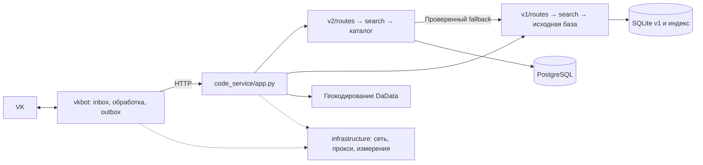

# Архитектура

Проект состоит из трёх частей: VK-бот, HTTP-сервис кодов и инфраструктура.
Версия API включает весь путь поиска, а не только URL маршрута.

## Структура кода

| Пакет или файл | Ответственность |
| --- | --- |
| `src/vkbot/` | Long Poll, восстановление истории, очередь, ограничение частоты, представление ответов и доставка в VK. Сервис кодов вызывается по HTTP. |
| `src/code_service/app.py` | Точка сборки Litestar: роутеры, зависимости, документация API, завершение работы. |
| `src/code_service/http.py`, `diagnostics.py`, `errors.py` | Общая HTTP-граница, диагностика и ошибки сценариев. |
| `src/code_service/geocoding.py` | Клиент DaData, одинаковый для обеих версий. |
| `src/code_service/config.py` | Настройки сервиса кодов. Настройки бота остаются в `vkbot/config.py`. |
| `src/code_service/v1/` | Совместимый поиск: `routes.py`, сценарии `search.py`, чтение SQLite `codes.py`, индекс `index.py`, сопоставление `matching.py`. |
| `src/code_service/v2/` | `routes.py`, сценарии `search.py`, разбор адреса `normalize.py`, ограничения `constraints.py`/`localities.py`, ранжирование `engine.py`, PostgreSQL `postgres.py`, создание читателя `catalog.py`, ограниченный кеш `cache.py`. |
| `src/infrastructure/` | Общие сетевые настройки, выбор прямого/прокси-маршрута, измерение этапов и версия приложения. Без зависимостей от бота или сервиса кодов. |
| `ops/` | Инфраструктура хоста: приём выпуска, развёртывание, откат и контроль хранения. Эти скрипты работают вне приложений. |
| `tools/` | Отдельные команды подготовки каталога, аудита переписок, оценки поиска, экспериментов и операций. [Порядок запуска](../tools/README.md). |

Роуты принимают параметры и вызывают сценарий. В них нет SQL или ранжирования.
Сценарии и читатели не зависят от Litestar. v1 не импортирует v2; v2 явно вызывает
v1 только для проверенного fallback. Бот не импортирует внутренности сервиса кодов.
Эти границы проверяются тестами по AST всех модулей, включая запрет обратных зависимостей.

Redis, `storages` и `KeyValueClientProtocol` не используются. Ограниченный кеш
ускоряет повторные запросы и не заменяет постоянную очередь.
Словари русского адресного языка вынесены в JSON отдельно для v1/v2;
[сравнение библиотек и граница грамматики](address-language.md).

## HTTP-контракт

| Операция | Основной путь | Совместимые пути |
| --- | --- | --- |
| Текст v1 | `GET /api/v1/codes?address=...` | `/api/v1/codes/msg?message=...`, `/codes/msg?message=...` |
| Текст v2 | `GET /api/v2/codes?address=...` | `/api/v2/codes/msg?message=...` |
| Геопоиск v1 | `GET /api/v1/codes/nearby?lat=...&lon=...` | `/api/v1/codes/geo`, `/codes/geo`, `/codes/nearby` |
| Геопоиск v2 | `GET /api/v2/codes/nearby?lat=...&lon=...` | `/api/v2/codes/geo` |
| Выбранный дом v2 | `GET /api/v2/buildings/{building_id}` | — |

Совместимые геопути принимают те же `lat`/`lon`. Параметр `observe=true` включает диагностику
для бота. GET поиска возвращает результат, в том числе `not_found`/`no_codes`, в теле ответа;
отсутствующий ID дома даёт 404, недоступность геокодера или чтения выбранного дома — 503.
POST к коллекции кодов не поддержан и возвращает 405. Документация OpenAPI доступна по `/docs`.

Текст и геометка v2 после определения адреса проходят один сценарий поиска. Проверенный fallback
сохраняет ограничения явно указанного города, улицы, дома, корпуса и буквы. Геокодирование не
подменяет отсутствующий дом соседним ради выдачи кодов.

## Проверки и развёртывание

Перенос модулей не меняет схему БД и данные каталога. Зафиксированные до переноса
результаты разбора 59 916 исторических запросов совпали после него. Дополнительно
проверяются полные ответы v1/v2, режимы SQLite/PostgreSQL, HTTP-контракты, очередь,
сетевые повторы, реальные Docker-образы и ограничения безопасности.

Readiness CI/CD проверяет HTTP-ответ именно v2: работающий fallback не маскирует
отказ каталога. При запуске обновления каталога механизм развёртывания выбирает
модуль внутри образа: новый `src.code_service.v2.catalog_update` либо прежний
`src.search.catalog_update`. Это позволяет откатываться на уже выпущенные образы.
Контрольные суммы замороженного prod v1 в `ops/legacy-v1-baseline.json` не меняются.

Экспериментальный адаптер `v2/opensearch.py` не включён в рабочем окружении.
Сравнения движков и их ограничения описаны отдельно в [исследовании поиска](search-experiments.md).

[Схема БД](database.md), [доставка сообщений](message-delivery.md), [CI/CD](cicd.md).
Разработка и приёмка выполняются на dev. Выпуск prod требует отдельного решения владельца.
