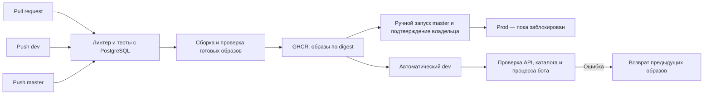

# CI/CD

Всё повторяемое описано в Git: workflow, `compose.deploy.yml`, приёмник и сценарии `ops/`.
Сервер не собирает образы и не подменяет их исходниками с диска.
Приложение разворачивается по полному SHA коммита и двум digest, а не по изменяемому `latest`.
На pull request работают проверки без секретов окружений и без публикации/деплоя.

## Обычный цикл

1. Изменения проходят локальные проверки и отправляются в `dev`.
2. **CI and deploy** запускает Ruff, тесты с настоящим PostgreSQL, собирает два образа и проверяет импорты без сети.
3. Только после успеха те же образы публикуются в GHCR. Сервер получает digest и размер каждого образа.
4. Environment `dev` предоставляет отдельный ограниченный SSH-ключ и закреплённые ключи хоста.
5. Сервер проверяет сообщество VK, наличие баз, работающий PostgreSQL и запас диска, скачивает образы по одному.
   Для нового образа нужен свободный объём не меньше двойного размера образа плюс резерв для БД.
6. Сохраняется последняя резервная копия очереди, затем останавливается старый процесс бота.
   API и бот заменяются внутри прежнего Compose-проекта. PostgreSQL и его том не пересоздаются.
7. Проверяется HTTP API; для PostgreSQL — поиск непосредственно в каталоге без скрывающего ошибку fallback.
   Проверка блокировки runtime подтверждает, что процесс бота прошёл проверку токена и занял своё сообщество.
   Тестовых сообщений пользователям эта проверка не отправляет.
8. Только после успеха обновляется состояние релиза. Сохраняются текущие и предыдущие образы.
   Удаляются только конкретные образы более старых CI-релизов приложения, без глобального `prune`.

Деплои и откаты одного окружения сериализованы и в Actions, и блокировкой на сервере.
Остановка выполняющегося деплоя новым push отключена. Устаревший push проверяется перед отправкой.
При потере связи нельзя считать релиз успешным только по результату SSH: проверьте run и серверное состояние.
Журнал незавершённого переключения позволяет следующему запуску сначала вернуть предыдущие образы.
После жёсткого выключения хоста восстановление не произойдёт само до следующего запуска деплоя/отката.

Ожидание готовности задаёт `DEPLOY_HEALTH_TIMEOUT_SECONDS` (120 секунд), резерв диска —
`DEPLOY_DISK_RESERVE_BYTES` (256 МиБ). Остальные ограничения контейнеров и сетевые таймауты остаются в серверном `.env`.
Между остановкой и запуском есть короткий перерыв; входящие сообщения восстанавливает сверка истории VK.
Нажатие кнопки, которое VK не доставил боту в этот промежуток, восстановить нельзя.

## Ошибка и откат

Ошибка до переключения оставляет текущие приложения работать. Если новая версия не проходит готовность,
сценарий возвращает предыдущие образы, повторно проверяет их и завершает Actions с ошибкой.
Отдельный **Rollback application** восстанавливает предыдущий сохранённый релиз без сборки и скачивания.
Для ручных workflow выбирайте соответствующую ветку: `dev` или `master`. GitHub показывает ручные workflow
после их появления в default-ветке; до переноса workflow в `master` доступен повтор уже существующего run,
а аварийный откат администратор вызывает ограниченным SSH-ключом командой `rollback`.

Откат приложения **не восстанавливает старую БД** и не возвращает уже отправленные сообщения.
Изменения схемы очереди должны быть совместимы с предыдущей версией. Разрушительные миграции,
публикация каталога и обновление PostgreSQL требуют отдельного подготовленного выпуска.
Автоматический откат не гарантирует устранение внешнего сбоя сети/VK/DaData.
При неуспешном откате run остаётся красным, журнал сохраняется для восстановления.

## Настройка окружений

В GitHub создаются `dev` (только ветка `dev`) и `prod` (только `master`).
Для `prod` требуется подтверждение `omkality`, обход администратором отключён.
Переменная репозитория `PROD_DEPLOY_ENABLED=false` дополнительно запрещает запуск prod.
Обычный push `master` не разворачивает prod даже после снятия этого запрета.

Секреты каждого Environment:

| Секрет | Назначение |
|---|---|
| `DEPLOY_HOST` | Хост окружения |
| `DEPLOY_SSH_KEY` | Отдельный SSH-ключ CI для этого окружения |
| `DEPLOY_KNOWN_HOSTS` | Ключи сервера, сверенные администратором заранее |

Токены VK/DaData, пароль PostgreSQL и DSN остаются в серверном `.env`; Actions их не получает.
GHCR использует краткоживущий `GITHUB_TOKEN`: он передаётся по SSH через stdin,
пишется Docker только во временный закрытый каталог и удаляется после скачивания.
Манифест релиза сохраняется в артефактах Actions 30 дней и не содержит секретов.
Сторонние Actions закреплены по SHA. Парольный root-доступ, sshd и VPN не меняются.
Ограниченный SSH-ключ разрешает только приём релиза и откат, без интерактивного shell, SFTP и туннелей.
Перед исполнением сервер сверяет SHA с текущей веткой GitHub и сравнивает полученные файлы
с опубликованным коммитом. Подмена сценария в SSH-пакете отклоняется. Недоступность GitHub
останавливает обновление до переключения, действующая версия продолжает работать.
При этом код trusted-ветки выполняет Docker с правами администратора: доступ на запись в неё нужно беречь.

Однократная установка: администратор доставляет **уже опубликованный** комплект `ops/` и `compose.deploy.yml`
из проверенного коммита, затем запускает `ops/bootstrap-ci.py --root <корень> --environment dev --public-key <путь>`.
Опция `--retire-obsolete-images` удаляет только старые теги образов этого приложения, сохраняя текущие образы отката.
После установки новые релизы доставляет Actions. Новый приёмник обновляется такой же явной установкой из Git.

Рабочая БД, файлы v1 и каталог должны быть подготовлены до первого CI-деплоя; workflow их не создаёт.
Для нового пустого сервера сначала восстанавливают данные и окружение по [инструкции эксплуатации](operations.md).
Установка prod-приёмника, его секретов, подготовка БД v2 и включение `PROD_DEPLOY_ENABLED` сейчас **не выполняются**.
Это отдельный этап после принятия dev и разрешения владельца; текущий prod v1.5.6 продолжает работать.

## Что смотреть

В Actions — зелёные проверки и deployment нужного Environment, SHA и digest в артефакте `release-<SHA>`.
На сервере — `.deployed-revision`, `.ci/state.json`, состояния контейнеров и готовность API.
Состояние `.ci/` закрыто от других пользователей; оно не является заменой резервной копии БД.
Ночные копии очереди продолжают работать отдельно от CI. Образы предыдущего релиза не следует удалять вручную.

## Обратимое обновление каталога dev

Полные копии ГАР не передаются на VDS. `tools/reconcile_street_order.py` и
`tools/reconcile_source_syntax.py` строят отдельных локальных кандидатов,
а `tools/build_catalog_patch.py` — закрытый сжатый патч с прежними и новыми
строками. Патч содержит коды и хранится вне Git; в образ входит только манифест с SHA-256,
ревизиями и размерами. Артефакт заранее помещается в закрытый каталог сервера.

Перед активацией Actions проверяет ревизию базы, контрольную сумму, размер патча и запас диска.
На время изменения останавливаются только API и dev-бот. Одноразовый ограниченный контейнер
выполняет одну транзакцию PostgreSQL: сверяет прежние строки, меняет данные и проверяет количества.
Для проверок внешних ключей внутри транзакции создаются два вспомогательных индекса;
перед фиксацией они удаляются, а при ошибке откатываются вместе с остальными изменениями.
Постоянная роль API остаётся только для чтения; административный пароль передаётся через
временный файл с правами 600 и удаляется после операции. PostgreSQL и VPN не перезапускаются.

После успешной транзакции обновляется `CATALOG_REVISION` в серверном `.env.dev`, затем запускаются
образы и проверки готовности. При ошибке патч применяется обратно и возвращаются прежние образы.
Журнал операции позволяет восстановиться после прерывания между изменением данных и запуском.
Ручной откат релиза также переключает данные и образы вместе; повтор операции безопасен.
Для первой такой публикации сначала развёртывается код поддержки без активного манифеста,
затем отдельным коммитом включается проверенное обновление данных.

Перестановки слов требуют патча около 5,9 МиБ, следующая сверка структуры адресов — около 6,3 МиБ
вместо второй полной БД.
На локальном PostgreSQL с лимитом 192 МиБ проверены применение, совпадение с независимо
загруженным каталогом и обратное восстановление контрольных сумм кодов и происхождения.
Этот механизм пока разрешён только для тестового сообщества на dev. Prod не изменяется.
