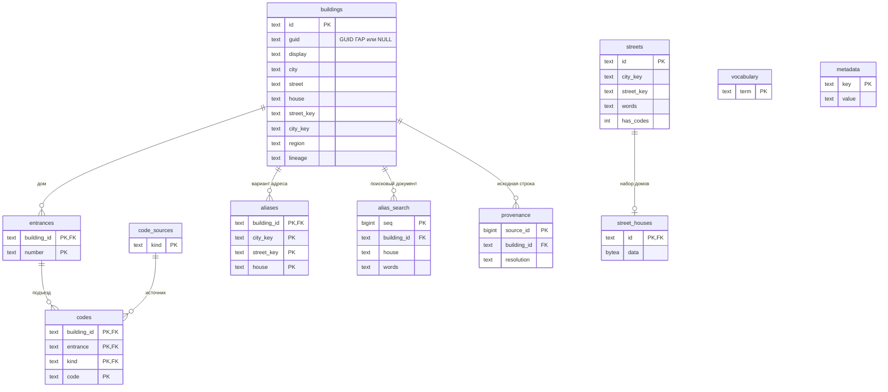
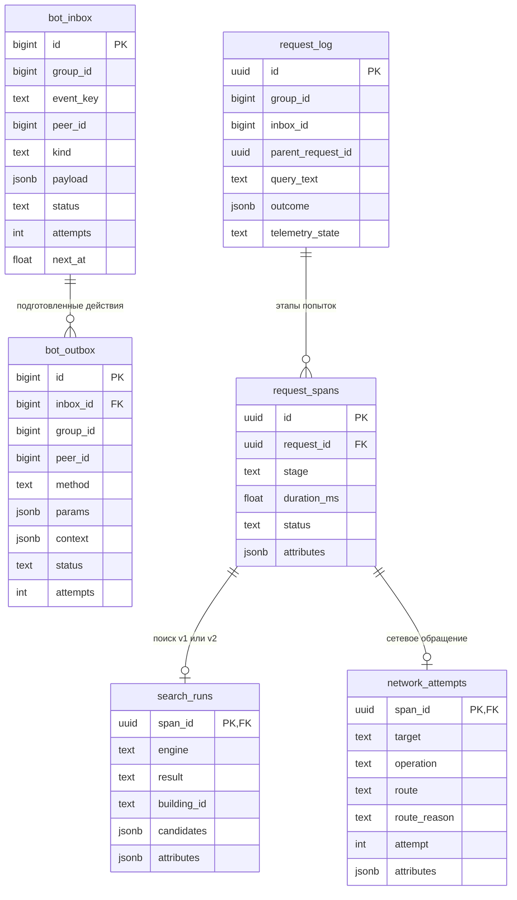

# Схема баз данных dev

Один экземпляр PostgreSQL обслуживает две отдельные БД:

- `domofomka` — inbox/outbox, контекст сообщений и ограниченная диагностика;
- `domofomka_catalog_<версия>` — нормализованные адреса, подъезды, коды и поисковые данные v2.

API читает каталог через отдельную роль без права записи. Бот записывает очередь в свою БД.
Исходная `codes.db` и её небольшой индекс остаются для v1 и проверки происхождения старых строк.
Полный XML ГАР и промежуточная сборка не переносятся на VDS.

Весь справочник действующих домов ГАР помещается на VDS благодаря компактному представлению:
дома без кодов находятся в `street_houses.data` как сжатый zlib JSON с общим адресом улицы
и списком номеров домов. Дома с кодами имеют отдельные связанные записи.
Это данные PostgreSQL, а не файлы индексов OpenSearch. Свежая БД с поисковыми индексами занимает
около 1,1 ГБ на диске; её размер не означает такой же расход оперативной памяти.
Промежуточная полная SQLite-сборка размером около 16 ГБ нужна только локально.

## Каталог адресов и кодов

Линии на схеме соответствуют внешним ключам. Сопоставление дома с документом улицы по
`city_key` и `street_key` — часть поискового алгоритма, а не внешний ключ.
Идентичность физического дома задаёт `buildings.id`; совпадение названия улицы в разных городах
не объединяет дома. GUID ГАР сохраняется только при подтверждённой привязке.

У кода составной первичный ключ `(building_id, entrance, kind, code)`.
Два одинаковых кода одного источника в одном подъезде объединяются;
другие коды, подъезды и источники сохраняются. Номер подъезда хранится текстом,
чтобы не терять исторические обозначения. В `code_sources` пока хранится только тип источника:
лишние сущности и выдуманные сведения об источниках не добавляются.

`provenance.source_id` — ID строки неизменённой исходной `codes.db`.
В `resolution` различаются `gar_exact`, `gar_locality_alias`, `gar_street_word_order`,
`gar_source_syntax_explicit_region`, `gar_source_syntax_embedded_type`, `ambiguous` и `unresolved`.
Это позволяет отличить точное совпадение от подтверждённого муниципального варианта,
перестановки слов или исправления структуры исходной записи и проследить объединённые дубли.
Контрольная сумма исходной базы находится в метаданных сборки; для сверки региона записана
также контрольная сумма фактов, извлечённых из региональных файлов ГАР.

`aliases` сохраняет варианты написания исходных адресов. `alias_search` — подготовленные слова для поиска
этих вариантов; `seq` сохраняет стабильный порядок кандидатов.
`vocabulary` — небольшой словарь для ограниченного исправления опечаток.

В `street_houses.data` находятся сжатые zlib JSON-наборы номеров домов, адресных префиксов и иерархий.
Так полный набор известных домов не разворачивается в десятки миллионов строк PostgreSQL.
Дома с кодами представлены обычными реляционными строками; для известного адреса без кодов
API создаёт устойчивый ключ `address:...`, не выдумывая GUID физического дома.
Это рабочий поисковый слой, а не полный редактируемый реестр ГАР.

Основные индексы:

- B-tree для дома, улицы, подъезда, источника и исходного ID;
- GIN по `to_tsvector('simple', words)` в `streets` и `alias_search`;
- отдельный частичный GIN для `streets WHERE has_codes=1` — быстрый первый поиск по адресам с кодами.

DDL и загрузка находятся в [`tools/catalog/build_postgres_catalog.py`](../tools/catalog/build_postgres_catalog.py).
При загрузке одинаковые названия улиц располагаются рядом: это уменьшает чтение страниц
для широкого запроса без изменения ранжирования. Для существующего dev предусмотрено
[однократное обслуживание через Actions](catalog-street-layout.md), без новой постоянной таблицы или индекса.
Схема каталога имеет версию `1`, независимо от версии REST API. Читатель проверяет версию, отметку готовности и заданную
контрольную сумму каталога; незавершённая или другая сборка не обслуживает v2.

## Очередь и измерения

Это сокращённая схема полей очереди; ключ события уникален по паре `(group_id, event_key)`.
Пара `(inbox_id, effect_index)` уникальна в outbox. Контекст кнопок хранится в
`bot_message_context` по сообществу, пользователю и ID сообщения.
`bot_state` хранит рабочие отметки, `bot_receipts` — идентификаторы для защиты от дублей после очистки тел заданий.
В `bot_state` ключ `reply_gate:<peer_id>` задаёт время следующего исходящего задания диалога.
`bot_inbox.payload._queue_disposition` объясняет отмену ещё не начатого запроса по лимиту
либо объединение повтора. Она не означает доставку; в диагностике такие планы имеют `cancelled`.
Эти поля используют существующие JSONB-структуры, новая таблица не добавляется.

Между `request_log` и inbox нет внешнего ключа: хранение диагностики независимо от очистки очереди.
Связь логическая, по сообществу и ID задания; сводку даёт представление `request_summary`.
Контекст и записи диагностики не ссылаются внешним ключом на каталог:
подготовленный ответ и записанное нажатие переживают смену версии каталога.

Поведение при повторах описано в [сценариях доставки](message-delivery.md),
поля измерений и ограничения — в [диагностике](telemetry.md).

## Обновление и восстановление

Первичная загрузка каталога выполняется в отдельную БД: данные, индексы, внешние ключи,
проверка корпуса и восстановление из дампа. Для ограниченного изменения dev используется
проверенный обратимый патч в одной транзакции; подробности — в [развёртывании](cicd.md).
Ревизия данных записана в `metadata.source_catalog_sha256` и `CATALOG_REVISION` серверного окружения.
После публикации API перезапускается, чтобы прежние кэшированные результаты не смешивались с новой ревизией.

Загрузчик работает только с отдельной локальной БД `domofomka_catalog_build_*`
и отказывается перезаписывать уже загруженные таблицы. Патч сверяет прежние строки и количества,
а журнал развёртывания связывает переключение данных с образами приложения.
Старые ID объединённых домов сохранены в `metadata.building_redirects`.

Дампы, патчи и исходные данные не входят в Git. Регулярных копий на ПК нет по решению владельца;
очередь резервируется на сервере с ограничением числа поколений.
Неизменяемый каталог воспроизводится из исходных данных; ежедневный гигабайтный дамп не создаётся.
Восстановление ролей и выдача `CONNECT`, `USAGE`, `SELECT` — отдельный шаг от восстановления данных.
Роль API не получает прав создания объектов, изменения таблиц или записи кодов.

Ограничения RAM, WAL, временных файлов, соединений и таймаутов задаются в `.env`.
`max_wal_size` — целевой размер для контрольных точек, а не жёсткий предел диска,
поэтому при восстановлении дополнительно контролируется свободное место.
