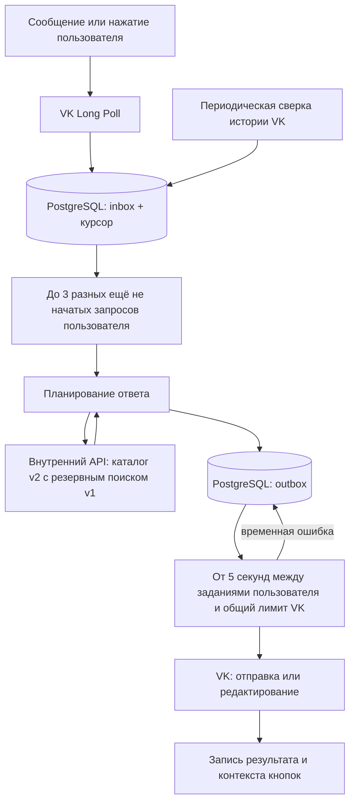

# Как теперь работает бот: доставка, очередь, кнопки и отказы

Эта инструкция описывает опубликованную ветку `dev` с постоянной очередью и поиском v2. Она развёрнута только для тестового сообщества **223949627** на Германии. Прод в Финляндии при этих работах не обновлялся. Подготовка каталога и численные результаты описаны в [документации поиска](search-v2.md).

## 1. Что мы хотим гарантировать

После успешной записи события в PostgreSQL временная ошибка сети или остановка процесса не должны превращать запрос в забытое сообщение. Незавершённая работа повторяется. Для накопившегося хвоста действует отдельный лимит: старые ещё не начатые запросы могут быть явно отменены в пользу новых, с сохранением причины и идентификаторов.

У этого обещания есть граница: бот должен получить событие и успеть сохранить его. Пропущенные обычные сообщения можно дополнительно найти в истории VK. История нажатий кнопок обратного вызова так не восстанавливается.

Очередь также не обещает, что внешний VK API выполнит действие ровно один раз при любых обстоятельствах и спустя произвольное время. Мы сохраняем идентификатор отправки, используем дедупликацию VK и записываем подтверждение отдельно, но не управляем внутренними гарантиями VK.

## 2. Устройство



**Inbox** — журнал полученных входящих событий. Здесь лежат сообщение или событие нажатия, идентификаторы пользователя и сообщества, время, состояние и попытки обработки.

**Outbox** — журнал конкретных действий, которые мы хотим выполнить во внешнем API: отправить сообщение либо отредактировать уже существующее. Действие содержит готовый текст, клавиатуру и целевые идентификаторы.

**Служебное состояние** — курсор Long Poll, граница успешной сверки истории, паузы, защита от повторных кликов, резервирование подтверждений и время следующей отправки пользователю.

**Контекст сообщения** — адрес и данные подъездов, необходимые для обработки его кнопок. Хранится в PostgreSQL. Redis для контекста не используется.

Поиск v1 сохраняет исходную SQLite. Поиск v2 читает нормализованный каталог ГАР в отдельной БД PostgreSQL; OpenSearch подключается по настройке для дополнительных кандидатов. Очередь и контекст кнопок хранятся в другой БД того же экземпляра PostgreSQL. Kafka для этой очереди не требуется.

## 3. Обычное сообщение без ошибок

Пример: пользователь отправляет адрес.

1. Long Poll отдаёт событие с сообщением.
2. Бот сохраняет событие в inbox и новый курсор Long Poll **одной транзакцией**.
3. Обработчик забирает задание, получает временную аренду задания и проверяет подписку. Для команды «начать» используется приветствие.
4. Внутренний API ищет адрес через v2; при отсутствии результата или недоступности каталога использует v1.
5. При найденных кодах готовятся адрес и кнопки подъездов. При неоднозначности — выбор адреса. Известный дом без кодов получает явное пояснение; если адрес не найден, бот просит указать город, улицу и номер дома.
6. Готовые действия записываются в outbox. В этой же транзакции inbox становится `done`.
7. Другой обработчик забирает outbox, отправляет ответ в VK и записывает результат.
8. Для сообщения с кнопками сохраняется `conversation_message_id` и контекст адреса.

Большое число подъездов разбивается на несколько сообщений, не больше 10 кнопок подъездов в каждом. Все части плана записываются атомарно, а доставляются последовательно в рамках диалога.

Обычные ответы при отправке ссылаются на исходное сообщение через `reply_to`. Редактирование сообщения VK может изменить вид этой ссылки в истории; локальный журнал уже принятого запроса остаётся главным источником его состояния.

## 4. Почему inbox может быть done, а ответа ещё нет

`inbox: done` означает **планирование закончено**, а не «пользователь уже получил ответ».

Пример состояния:

| Запись | Статус | Значение |
|---|---|---|
| Inbox адреса | done | Ответ подготовлен и надёжно записан |
| Outbox отправки | pending | VK пока не принял ответ либо результат ещё не подтверждён |

Поэтому для диагностики доставки надо смотреть обе очереди. Состояния обеих таблиц имеют одинаковые названия, но описывают разные этапы:

| Статус | Inbox | Outbox |
|---|---|---|
| pending | Ожидает планирования/повтора | Ожидает доставки/повтора |
| processing | Обработчик формирует план | Обработчик выполняет действие VK |
| done | План сохранён; повтор объединён; либо запрос явно отменён по лимиту | Доставка подтверждена либо неначатое действие отменено вместе со всем запросом |
| failed | Обработка требует исправления причины | Внешнее действие требует исправления причины |

Объединённый повтор кнопки тоже имеет `done`, но не создаёт собственного действия. В его служебной квитанции записан ID исходного inbox-задания.
Отмена по лимиту записывает `_queue_disposition`: `pending_limit` или `superseded_duplicate`.
Диагностика показывает `cancelled`, а не принятие ответа VK; один статус `done` не доказывает доставку.

## 5. Поиск адреса или проверка подписки зависли

**Что видит пользователь:** ответа пока нет.

**Что происходит внутри:** inbox остаётся незавершённым. После исчерпания коротких HTTP-повторов задание возвращается в `pending` с временем следующей попытки. Его не помечают успешно обработанным только потому, что истёк таймаут.

Для текстовых запросов после восстановления сервиса бот повторяет планирование. Для недоступного геокодирования действует отдельный сценарий с просьбой отправить текстовый адрес, описанный ниже. Поскольку план и завершение inbox сохраняются атомарно, повтор не создаёт второй комплект outbox-действий.

Если ошибка временная, автоматические попытки не имеют предела по количеству. Если причина постоянная, задание остаётся `failed` для разбора оператором.

## 6. VK недоступен до отправки ответа

Адрес найден, outbox уже записан, но соединение с VK не устанавливается.

Тогда outbox остаётся `pending`, увеличивается счётчик попыток и назначается повтор. Повтор использует **тот же** `random_id`, который связан с постоянным ID outbox. Готовый текст ответа сохраняется; бот не обязан заново искать адрес при каждой попытке доставки.

Данные не исчезают после перезапуска контейнера. Не нужно просить пользователя заново отправлять адрес из-за одного таймаута.

## 7. VK принял сообщение, но подтверждение потерялось

Это самый неприятный вариант: отправка фактически состоялась, но наш процесс получил таймаут и не знает результата.

1. Outbox остаётся незавершённым.
2. Следующая попытка отправляет тот же текст тому же получателю с тем же `random_id`.
3. Дедупликация VK должна предотвратить второе сообщение.
4. Полученный результат сохраняется в outbox.

Этот сценарий проверялся на настоящем тестовом боте: искусственный отказ после принятия VK привёл к двум попыткам доставки, а в истории оказалось одно сообщение.

Это практическая защита от дублей, а не обещание бесконечной гарантии доставки ровно один раз. Если удалить PostgreSQL, откатить его на старую копию или одновременно запустить независимые очереди для одного сообщества, основание для такой гарантии нарушится.

## 8. Результат отправки сохранён, но чтение контекста не удалось

Сообщение уже отправлено, его ID записан. Следующий запрос `getById`, нужный для контекста кнопок, завершился таймаутом.

При повторе бот видит сохранённый результат и **не отправляет сообщение заново**. Он повторяет получение контекста, затем завершает outbox.

Если пользователь успел нажать кнопку до сохранения контекста, обработчик умеет прочитать исходное сообщение VK, взять из него адрес и восстановить данные через внутренний API.

## 9. Обычное нажатие кнопки

1. VK присылает `message_event` с `event_id`, пользователем, сообщением и выбранным подъездом.
2. Событие сохраняется в inbox вместе с решением защиты от повторных кликов.
3. По возможности отправляется пустое `sendMessageEventAnswer`, без всплывающего текста.
4. Обработчик получает контекст адреса и формирует нужный текст кода.
5. Редактирование записывается в outbox.
6. Outbox редактирует исходное сообщение и завершает задание.

Подтверждение кнопки и выдача кода — разные действия. Подтверждение не означает, что код уже выдан. Оно не является обычным сообщением в диалоге и не проходит через очередь обязательной доставки.

В официальной схеме VK `event_data` необязателен. Запрос без текста реализован и проверен на уровне формируемых параметров. Проверка его отображения в клиенте VK требует свежего реального нажатия; браузерный инструмент заблокировал доступ к сайту, поэтому этот визуальный результат не следует считать автоматически проверенным.

### Выбор адреса перед выбором подъезда

Если v2 нашёл несколько подходящих адресов с кодами, бот показывает по пять вариантов на странице и кнопки перехода.
Один адрес с кодами открывается сразу. Несколько домов без кодов не превращаются в меню.
Кнопка «Ни один не подходит» убирает клавиатуру и редактирует то же сообщение: нужно прислать весь адрес одним сообщением.
Выбор или отказ закрывает список; запоздавшая кнопка страницы не может открыть его заново.
Для старых сообщений без маркера закрытия проверяется сохранённый контекст: если адрес уже выбран,
повторный выбор или переход страницы игнорируется без ошибки и без обращения к поисковому API.
В контексте сообщения сохраняется весь предложенный список. Кнопки `select_building` и `choice_page`
могут работать только с этим списком; прислать произвольный идентификатор дома через такую кнопку нельзя.

Выбор адреса редактирует то же сообщение в адрес с подъездами. Если подъездов больше десяти,
дополнительные группы приходят отдельными сообщениями. Дом без кодов получает явное пояснение без кнопок подъездов.
Нажатие подъезда затем редактирует сообщение до кода обычным механизмом outbox.

Если после обновления каталога выбранный идентификатор перестал существовать, ответ HTTP 404 превращается
в просьбу прислать адрес заново. Старые кнопки убираются; бесконечный повтор заведомо отсутствующего дома не создаётся.

## 10. Пользователь быстро нажимает одну кнопку много раз

Защита общая для всех кнопок пользователя в личном диалоге: подъездов, адресов, страниц и отказа от выбора.

При повторе система смотрит на последнее принятое действие в диалоге:

- Пока принятое действие не доставлено, новые нажатия не создают дополнительных поисков и редактирований. Это действует и после истечения пяти секунд.
- После доставки всех исходящих действий действует `ANTI_SPAM_TIME`: по умолчанию 5 секунд от завершения доставки. После перезапуска эта граница сохраняется.
- Если исходное действие завершилось постоянной ошибкой, новое явное нажатие можно принять сразу.

Повтор сохраняется как обработанная запись для дедупликации и диагностики, но **не создаёт нового поиска/редактирования**. Сами входящие события всё ещё занимают место в БД; это ограничение активной работы, а не система очистки журнала.

Спам не продлевает короткую паузу бесконечно: подавленные клики не сдвигают её начало.

При успешном завершении после истечения паузы новое нажатие снова принимается. Бот может ещё раз отредактировать сообщение тем же кодом; бесконечного подавления повторов нет.

## 11. Какие уведомления появляются при повторах

| Ситуация | Всплывающий текст |
|---|---|
| Обычный новый клик | Нет текста |
| Любая кнопка в пределах короткой паузы | «Подождите N сек.» |
| Исходная задача уже пережила сбой или остаётся незавершённой после паузы | «Запрос сохранён, повторно нажимать не нужно.» |
| Новый клик, перед которым в диалоге есть известный сбой доставки | «Запрос сохранён, повторно нажимать не нужно.» |

Предупреждение отправляется не чаще одного раза в 10 секунд **на пользователя**, а не на каждую кнопку. Скрытые подтверждения ограничены интервалом 1 секунда. Первое предупреждение может прийти сразу после обычного пустого подтверждения: это отдельный бюджет, чтобы первая быстрая повторная попытка получила объяснение. Общий ограничитель HTTP всё равно применяется.

Поэтому для серии из 40 одинаковых кликов в одном моменте проверка получила: одну активную задачу, одно пустое подтверждение, одно предупреждение и 38 событий без дополнительного обращения к VK.

При сильном спаме некоторые события намеренно не получают отдельного API-подтверждения. На части кнопок индикатор может оставаться до таймаута клиента: мгновенно подтверждать бесконечное число кликов и одновременно ограничивать число API-запросов невозможно. На сохранность исходного задания это не влияет.

## 12. Пользователь меняет подъезд: 1 → 2 → 1

Если нажать все три подряд, принимается первое действие. Быстрые переключения на другие подъезды подавляются тем же ограничением, что и повтор одинаковой кнопки.

Чтобы выбрать другой подъезд, нужно дождаться результата и короткой паузы. Это сохраняет поведение прежнего ограничения master и не даёт обходить его чередованием кнопок.

Проверка серии из 40 чередующихся действий подтвердила не более одного активного задания. Входящие события всё ещё сохраняются в журнал; это ограничение работы и исходящих запросов, а не полная защита от сетевых атак или роста БД.

## 13. Нажатие получено, но редактирование завершилось таймаутом

Событие нажатия уже в inbox, готовое редактирование — в outbox. Ошибка редактирования не заставляет забыть нажатие.

Следующая попытка редактирует **то же сообщение тем же подготовленным текстом и клавиатурой**. Повторное редактирование не создаёт новых сообщений. Если VK успел применить первое редактирование, повтор ещё раз приводит сообщение к требуемому состоянию.

Другие действия этого диалога ждут завершения предыдущего outbox-действия. Поэтому старый результат не должен штатно приходить после более нового результата при обычной последовательной обработке.

Если пользователь повторно нажимает ту же кнопку во время сбоя, он ссылается на исходную задачу, а не заказывает десятки повторных редактирований.

## 14. Короткоживущее подтверждение кнопки не удалось

Подтверждение сначала резервируется в PostgreSQL как уже предпринятое и только потом отправляется в VK. Один и тот же `event_id` не порождает повторных уведомлений при повторной выдаче события Long Poll.

Если процесс упал после резервирования, но до API-запроса, подтверждение может не появиться. Это осознанная уступка: уведомления нельзя бесконечно повторять и ставить впереди фактической выдачи кода.

Если подтверждение просрочено или сеть недоступна, ошибка записывается в безопасном виде, а основное задание продолжает работать. При ошибках VK 6/9/29 включается общая пауза обращений к VK, и отправка подтверждений текущей порции прекращается.

Текст о сохранённом запросе показывается, когда задержка уже известна на момент нового нажатия. Бот не создаёт отдельное обычное сообщение после каждого сетевого таймаута: такие сообщения тоже могли бы засорять диалог и увеличивать нагрузку.

## 15. Контейнер упал во время обработки

При взятии задания обработчик получает lease — временное право им заниматься. По умолчанию это 120 секунд, с продлением приблизительно каждые 40 секунд, пока обработчик работает.

Если процесс погиб, продление прекращается. После истечения аренды задания задание может быть взято заново. Поэтому восстановление после внезапной остановки может потребовать ожидания до окончания lease; это не фиксированное обещание ответа за 120 секунд, к ожиданию может добавиться сеть и задержка повтора.

Прежний владелец не может завершить задание, если его уже забрал другой обработчик. Перед доставкой право на обработку перепроверяется. Для отправки остаётся тот же `random_id`.

Проверка «право ещё наше» и вызов внешнего VK не являются одной общей транзакцией. Это одна из причин, почему мы не заявляем безусловную доставку ровно один раз или готовое автоматическое переключение серверов.

## 16. PostgreSQL недоступен

Если события уже записаны, они останутся в постоянном томе после перезапуска БД.

Если бот получил новую порцию Long Poll, но БД недоступна, он повторяет сохранение **той же порции**, не переходит к следующей и не сохраняет курсор отдельно от событий.

Если одновременно погибнет процесс, пока порция была только в памяти, восстановление зависит от повторной выдачи событий VK. Обычные сообщения дополнительно найдёт сверка истории. Для события нажатия, которое так и не попало в БД, универсального восстановления нет.

Полная потеря диска PostgreSQL — другой класс отказа. Для него нужна резервная копия, а не только перезапуск Docker.

## 17. Бот был выключен и не получил обычные сообщения

Сверка истории выполняется при старте и затем каждые 5 минут. Она просматривает личные диалоги и заносит обнаруженные входящие сообщения в тот же inbox.

Если событие уже пришло через Long Poll, уникальный ключ не даст добавить вторую задачу. Отдельной очереди «старых пользователей» нет: найденные запросы обрабатываются тем же механизмом и имеют ту же защиту от повторной отправки.

Сообщения внутри диалога идут в порядке постановки в очередь. Обнаруженный позднее старый запрос может оказаться позади уже полученных событий; глобальная сортировка всей очереди по времени пользователя не выполняется.

### Ограничение накопленного хвоста

`QUEUE_MAX_PENDING_MESSAGES_PER_PEER=3` оставляет три последних разных ещё не начатых запроса
одного пользователя. Порядок для отбора определяется временем сообщения и его идентификатором VK,
а не временем обнаружения. Лимит общий для истории и Long Poll, разных пользователей и сообществ
он не смешивает. Текст сравнивается без различий регистра и повторных пробелов; геолокация,
вложения, payload, ответ на другое сообщение и пересылки входят в сравнение отдельно.

Учитываются и подготовленные outbox-планы, если ни одно действие плана ещё не запускалось.
Устаревший план отменяется целиком; исходный запрос и его ID остаются в журнале.
Повторная сверка истории не возвращает отменённое задание в работу. Отдельное уведомление
на каждый отброшенный запрос не отправляется.

Начатая попытка отправки с неизвестным результатом сохраняет свой `random_id`. Если уже отправлена
хотя бы одна часть ответа, остальные части также сохраняются. Поэтому три — лимит сокращаемых
запросов, а не абсолютный предел числа сообщений: ответ на дом с множеством подъездов может
содержать несколько страниц, а начатую отправку необходимо корректно завершить.

`OUTBOX_PEER_MIN_INTERVAL_SECONDS=5` задаёт паузу между исходящими заданиями одного пользователя,
включая отправку и редактирование. Граница резервируется перед обработкой и продлевается после
завершения либо ошибки попытки. Она хранится в PostgreSQL и переживает перезапуск.
Ожидающее задание получает `next_at`; рабочий поток не засыпает на пять секунд ради этого диалога
и может обслуживать другого пользователя. Общий `VK_MIN_INTERVAL_SECONDS` продолжает ограничивать
все HTTP-вызовы, включая внутренние сетевые повторы одного и того же действия.

Первый запуск новых правил сокращает существующий неначатый хвост; ограничение проверяется также
при приёме, подготовке и взятии задания. Частично отправленные ответы, callbacks и отложенная
геолокация сохраняют свои отдельные правила.

Проверка `c9813fc`: [CI/CD](https://github.com/omkality/domofomka/actions/runs/42325735697),
616 тестов и один платформенный пропуск. Локально — 615 тестов и два пропуска. На Германии
семь искусственных сообщений проверены в отдельной временной БД без вызовов VK. Для первого
пользователя сохранены три запроса, интервалы — 5,070 и 5,108 секунды; задание второго пользователя
обработано за 0,307 секунды. Перезапуск сохранил паузу, временная БД удалена.
[Агрегаты](queue-limits-verification.json).

## 18. Как выбирается период истории

Пример: успешная сверка закончилась в 12:00, после этого бот был выключен до 18:00.

При следующем проходе нижняя граница будет примерно **11:45**, а не 17:45: берётся граница последней успешной сверки минус 15 минут перекрытия. Поэтому простой в шесть часов не ограничивается поиском только последних 15 минут.

Граница сверки обновляется только после успешного полного прохода. Если десять диалогов обработаны, а на одиннадцатом VK дал таймаут, уже сохранённые события остаются, но граница сверки не продвигается. Следующий проход повторит участок; дедупликация устранит повторы.

На первой установке ещё нет сохранённой границы. Тогда используется окно 24 часа до начала локального отслеживания. Сообщения старше окна по умолчанию не восстанавливаются. Окно можно менять настройкой до первого запуска или отдельно разбирать старую историю оператором.

## 19. Как понять, что старое сообщение уже получило ответ

Для новых запросов основной ответ — собственный inbox/outbox-журнал. Если VK-история содержит явную ссылку ответа на конкретное входящее сообщение, она также учитывается при восстановлении.

Для сообщений до установки очереди такой журнал отсутствует. Используется эвристика: сообщения до последнего исходящего считаются уже обработанными, а хвост после него может быть восстановлен.

Эта эвристика не доказывает, что старый ответ действительно относился к каждому старому запросу. Например, массовое уведомление могло закрыть хвост внешне, хотя код не был выдан. Поэтому старую историю нельзя автоматически объявить идеально восстановленной.

После начала локального отслеживания неизвестный новый запрос не считается отвеченным просто потому, что в диалоге есть более позднее исходящее уведомление.

История читается с пагинацией, а не как неизменяемый снимок. Активность диалогов во время обхода может двигать страницы; перекрытие и повторные обходы уменьшают риск, но не дают математической гарантии полного снимка.

## 20. VK ограничил запросы или запретил сообщения

Действуют несколько разных механизмов:

| Механизм | Для чего нужен |
|---|---|
| Общий интервал HTTP 0,4 секунды | Ограничивает фактические запросы, включая HTTP-повторы |
| Объединение одинаковых кликов | Не даёт плодить одинаковую работу |
| Лимит предупреждений 10 секунд | Не даёт отвечать всплывающим текстом на каждый клик |
| Общая пауза при VK 5/6/9/27/29 у обработчика | Приостанавливает исполнение после ошибок авторизации/ограничения |
| Повтор задания с увеличением задержки | Не даёт непрерывно повторять одно неудачное действие |

0,4 секунды — выбранная настройка, а не официальная гарантия допустимого темпа для всех методов и ситуаций. На ответы VK надо реагировать даже при консервативном интервале.

Запрет сообщений пользователем, некорректные параметры и другие постоянные ошибки переводят задание в `failed`. Оно сохраняется для разбора, но перестаёт бесконечно задерживать все последующие запросы диалога.

Сетевые сбои, HTTP-ошибки и не классифицированные как постоянные ошибки обычно повторяются. Реальная классификация находится в работающем коде; операционная проверка `failed` всё равно нужна.

## 21. Через сколько будет следующая попытка

По умолчанию задержки примерно 5, 10, 20, 40 секунд и далее до 300 секунд, с небольшим случайным разбросом. Потолок 300 секунд применяется после разброса. Если включена общая пауза VK, она тоже должна закончиться.

Это задержка **между попытками задания**, а не общее время ответа. Одна HTTP-операция может сначала сделать до трёх коротких попыток для разрешённых безопасных методов. В HTTP-обёртке по умолчанию таймаут подключения 5 секунд и чтения 20 секунд; явно заданный таймаут Long Poll сохраняется.

Таймаут HTTP не означает, что пользовательский запрос выброшен. Он означает, что текущую попытку нельзя бесконечно держать открытой.

## 22. Один пользователь ждёт — что с остальными

Внутри одной очереди задания одного диалога последовательно ждут предыдущие незавершённые задания. Это защищает порядок редактирований. Другой пользователь может обрабатываться параллельно.

По умолчанию работает два обработчика inbox и два обработчика outbox. Если оба заняты медленными внешними запросами, другие задания тоже временно ждут. Ограничитель частоты VK общий для всех потоков одного процесса бота.
Пауза отдельного пользователя хранится в БД и не занимает обработчик ожиданием этой паузы.

Полная недоступность VK влияет на всех. Очередь обеспечивает сохранность и повторы, а не независимый альтернативный путь доставки.

## 23. Одновременно запустили вторую копию

Перед запуском обработчиков токен проверяется на доступ к указанному сообществу. Затем процесс бота берёт блокировку PostgreSQL для своего group_id. Вторая копия на **той же БД** не должна стать вторым активным процессом бота этого сообщества.

Это не распределённый балансировщик и не готовый автоматическое переключение при отказе. Если Германии и Финляндии дать разные PostgreSQL и одинаковый токен, их блокировки друг друга не увидят. Так делать нельзя.

В текущей схеме dev и prod используют разные сообщества и очереди. Старый немецкий prod остановлен. VPN-сервисы в этот механизм не входят.

## 24. Что может сделать оператор

Команды запускаются внутри контейнера с настройками нужного окружения:

```bash
python -m src.vkbot.manage status
python -m src.vkbot.manage pause
python -m src.vkbot.manage resume
python -m src.vkbot.manage retry-failed
```

`pause` прекращает взятие новых заданий, но не убивает уже выполняющиеся HTTP-запросы. Сбор событий и сверка истории продолжаются. `resume` возобновляет работу.

`retry-failed` возвращает сохранённые ошибки в очередь. Это операторская команда, а не универсальное лечение: сначала надо исправить причину. Возвращённое старое редактирование может изменить старое сообщение; перед массовым повтором надо понимать, какие задания повторяются.

В окружении разработки доступны синтетические отказы: `api`, `vk-send`, `vk-send-after`, `vk-edit`, `vk-edit-after`. Они разрешены только для тестовой группы 223949627. Состояние отказов хранится в БД и переживает перезапуск, поэтому завершение теста включает явное выключение имитации отказа.

## 25. Какие автоматические проверки здесь особенно полезны

- Небольшой хвост из 6–8 искусственных сообщений после полудня простоя: остаются три последних разных запроса.
- Повторы не заполняют все три места; другой контекст сообщения не склеивается с исходным.
- Перезапуск, одновременный приём и отправка, сохранение неопределённой отправки и оставшихся страниц ответа.
- Интервалы одного пользователя сохраняются; другой пользователь обслуживается во время его паузы.
- Отмена целого неначатого плана не попадает в аналитику как подтверждённая доставка.

- 40 повторов одной кнопки: одно редактирование, ограниченное число подтверждений.
- Чередование подъездов, адресов и страниц: не обходит общее ограничение; новое действие принимается после доставки и паузы.
- Незавершённое редактирование после окончания паузы: новые повторы не создают второе действие.
- Перезапуск между таймаутом и повтором: исходная задача и защита продолжают работать.
- Одновременная запись повторов из нескольких потоков: один активный исходный клик.
- Ошибка сохранения порции: откатываются inbox, состояние защиты и курсор вместе.
- Повтор той же порции Long Poll: ни нового задания, ни нового подтверждения.
- Потеря подтверждения отправки после принятия VK: тот же random_id.
- Сохранённый результат отправки и ошибка получения контекста: повторной отправки нет.
- Ограничение VK при подтверждении: текущая порция уведомлений прекращается, включается пауза.

Часть тестов использует настоящий PostgreSQL в отдельных случайных пространствах group_id. Они не чистят рабочие данные dev. Сценарии HTTP-повторов проверяются отдельно. Эти проверки не являются массовой нагрузкой на живое VK API.

## 26. Что обязательно учитывать при эксплуатации

Постоянный том PostgreSQL нельзя удалять как одноразовый кэш. В нём находятся задания и последовательность идентификаторов отправки. Нужна резервная копия, например `pg_dump`, и проверяемое восстановление.

В БД хранятся тексты пользователей и подготовленные ответы. Порты БД закрыты снаружи, секреты не включаются в Git, а сообщения исключены из текстов технических ошибок. Защита резервной копии должна соответствовать защите самой БД.

Завершённые тела заданий очищаются после срока хранения, но идентификаторы событий сохраняются для дедупликации.
Незавершённые задания и ошибки не удаляются. Для резервного копирования предусмотрен ежедневный таймер и проверка восстановления.
Пороги ресурсов, ограничения и команды находятся в [инструкции эксплуатации](operations.md).

Сеть Германии остаётся внешней зависимостью. Новая схема позволяет пережить временный разрыв, но не исправляет маршрутизацию и не гарантирует время восстановления. Перенос prod из Финляндии назад на нестабильный сервер этой доработкой не выполняется.


## 27. Срочный хотфикс геолокации — v1.5.4

Это архивное описание хотфикса v1.5.4 от 21.10.2026, опубликованного в master и установленного в Финляндии. Числа ниже относятся к тому релизу; текущие таймауты задаются в `.env` по примерам настроек. В старой схеме запрос DaData мог ждать около 30 секунд. Ошибка геозапроса затем прерывала генератор Long Poll, из-за чего оставшиеся события из той же порции могли не обработаться.

Теперь запрос DaData имеет общий срок ожидания 8 секунд и таймаут транспорта. После ошибки на 30 секунд открывается защита от повторных обращений к недоступному сервису в процессе API: новые экземпляры клиента этого процесса сразу сообщают о временной недоступности. У нескольких процессов API это состояние отдельное, а не общий Redis-флаг.

API отвечает 503 вместо смешивания недоступности сервиса с «Нет результатов». Прод-обработчик сообщает: «Не удалось определить адрес по геолокации. Пожалуйста, отправьте адрес текстом». Запрос бота к внутреннему гео-API тоже ограничен 12 секундами. Ошибка отдельного события больше не прерывает всю полученную порцию Long Poll.

В текущем dev геолокация после уведомления сохраняется для отложенного повтора и не блокирует новые сообщения.
Новое сообщение отменяет её; исчерпание окна попыток оставляет явную ошибку для оператора.
Подробности и параметры находятся в [описании отложенной геолокации](operations.md#отложенная-геолокация).

Геокодирование по-прежнему зависит от доступности DaData. Хотфикс не гарантирует геоответ, когда внешний сервис недоступен, и не делает старый master параллельным: первый геосбой ещё может задержать последовательный обработчик примерно на 8 секунд. Исправление убирает длинное ожидание и потерю остальных событий из порции.
