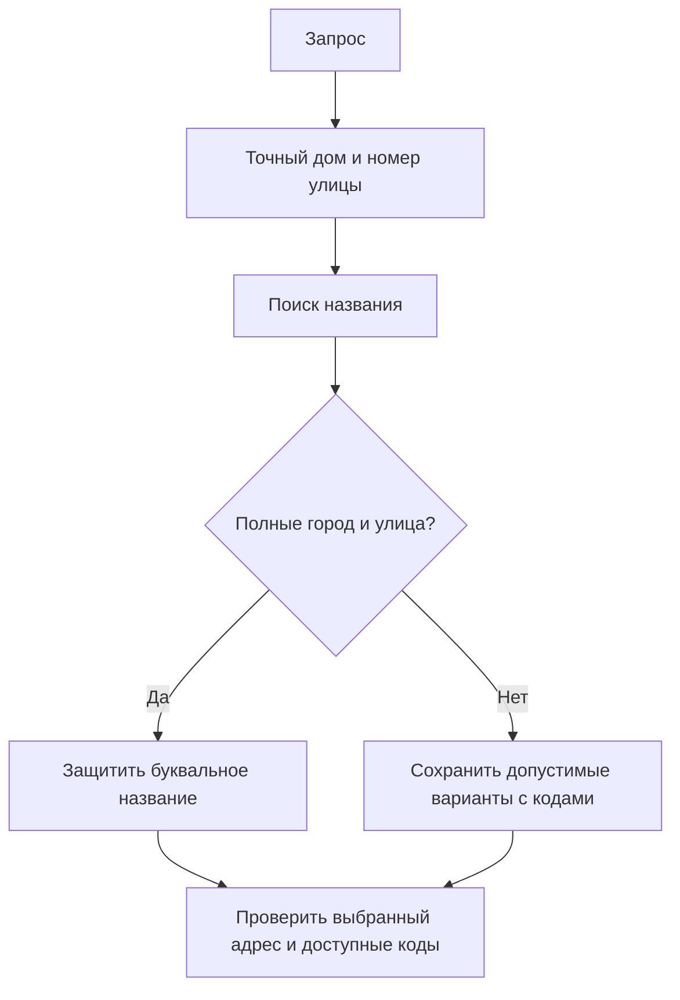

# Сохранность адресов и кодов — 7 ноября 2026

Общие проверки названия исправлены в `82ad21e` и развёрнуты на немецком dev с PostgreSQL.
Native-ранжирование OpenSearch остаётся локальным экспериментом. Master, prod, VPN и закреп VK не менялись.
Это продолжение [предыдущего разбора](search-name-identity.md), а не разрешение выпуска.
Следующие исправления исходных вариантов и уточнённый аудит кодов описаны
в [продолжении](search-source-coverage.md). Числа ниже относятся к предыдущей сборке.

## Исправления

Разобраны 67 записей с 65 разными текстами потерь native относительно каталога. В 41 записи
точный адрес без кодов закрывал доступ к подходящему кодовому варианту; в остальных сокращалось меню.
Отдельно воспроизведён дефект рабочего каталога: полностью указанные город и улица с известным
домом без кодов могли привести к кодам другой, более длинной улицы.

Исправлена проверка фактически выбранных кандидатов: одного точного среди нескольких недостаточно.
Полностью указанные город и улица защищают свой адрес от подмены более длинным названием.
Короткий запрос без города сохраняет допустимые варианты с кодами. Равноправные исходные варианты
остаются отдельными, а не объединяются по баллу. Синонимы типов учитываются, значимые слова и инициалы
сохраняются. Буквы домов, корпуса, строения, диапазоны и номера улиц не исправляются fuzzy-поиском.



OpenSearch ранжирует нечёткие совпадения. Общие Python-проверки задают ограничения идентичности
и правила выбора, не заменяя fuzzy Python-оценкой сходства. Лабораторная политика сохранения
буквальных вариантов включается при реальных точных попаданиях, а не расширяет любой нечёткий ответ.

## Полный повтор

Каталог не менялся: `9d79c9fed085ef3c289d660c5fa5dbbb1d5639943b67aeed1618892e34c8ec0a`.
Исходная `codes.db` и происхождение кодов также сохранены. Проверены 46 908 записей:
44 083 исторические подсказки, 2 528 гипотез исправления и 297 размеченных ограничений.
Для каталога и полного индекса получены 93 816 ответов, для сокращённого — ещё 46 908.
Проверены замороженные исходники, настройки и полнота параллельных фрагментов. Ошибок движка
и конфликтов 297 ограничений нет.

| Маршрут | Историческая подсказка, из 44 083 | Подсказка исправления, из 2 528 |
| --- | ---: | ---: |
| Каталог и допустимый v1 | 44 002 | 1 396 |
| Native с полным индексом, каталог и допустимый v1 | 44 002 | 1 588 |
| Native с индексом улиц с кодами, каталог и допустимый v1 | 44 002 | 1 616 |

Построчная сверка не обнаружила потерь подсказок native относительно каталога. Сокращение индекса
добавило 28 подсказок исправления без потери сохранённых полным индексом. Это совместимость,
не точность: v1 тоже ошибается, а неуказанный город не доказан. Меню считается сохранённым вариантом,
не автоматическим ответом. Показатели относятся к составному маршруту с резервными каталогом и v1.

Пилот: 1 615 записей, включая 65 уже исследованных текстов потерь. Это регрессия, не независимый контроль.
Native сохранил 65 из 65 таких подсказок, прежняя политика — 0 из 65. Историческая часть — 500 из 500
у всех вариантов. На 453 предполагаемых опечатках: каталог 381, полный индекс 439, сокращённый 452.
В пересекающихся стратах — 399 ручных ограничений с порядковыми формами улиц и 193 контекстные проверки.
Конфликтов нет; из 32 наблюдаемых последующих уточнений native предлагает коды в 32 случаях, каталог — в 9.
Пересекающиеся страты нельзя складывать.

## Проверка самих кодов

`tools/evaluation/audit_search_code_coverage.py` сравнивает фактические коды v1 с кодами сохранённых результатов.
Используется настоящий индекс совместимости, а не первый адрес облегчённого воспроизведения.
Единица — уникальный кортеж «подъезд, источник, код». Для меню учитывается объединение доступных
через отдельные кнопки наборов; это не означает автоматическую отправку или идентичность домов.

Совпадение адреса не гарантирует сохранность набора кодов. Однако различие наборов тоже не всегда баг:
v1 добавлял к запросу 13-й улицы и дома 4 коды 3-й улицы и дома 14 из-за совпадения подстрок.
Исключать эти коды правильно. Другие случаи связаны с неподтверждёнными исходными полями адресов;
их нельзя молча объединять с официальным домом. Оставшиеся группы входят в незакрытую задачу #10.
Агрегаты — в [JSON](search-coverage-summary.json), построчные данные — только в `artifacts/private`.

Проверены 41 918 разных текстов, соответствующих 44 083 историческим записям. В 43 969 записях
фактический v1 имеет коды. Среди ответов с сохранённой адресной подсказкой отличия кодовых наборов
есть в 178 записях каталога и трёх записях каждого нового native-варианта. Показатель каталога
не изменился относительно предыдущего снимка. Из трёх native-случаев один подтверждён как исключение
чужой улицы/дома из v1, два относятся к неподтверждённым исходным группам. Эти числа нельзя объявлять
числом неверных ответов или исправлять без проверки происхождения.

Сама защита полного названия изменила 14 ответов каталога; в десяти сузился набор кодов, доступных
через варианты. Исторические подсказки v1 сохранены. Отличия относительно предыдущего v2 также
оставлены на проверку исходных групп до выпуска: одной метрики совместимости v1 недостаточно.

Локальный запуск без VK:

```powershell
python -m tools.evaluation.audit_search_code_coverage `
  --results artifacts/private/<run> `
  --catalog artifacts/search/<frozen-catalog.db> `
  --output artifacts/private/<new-code-audit> --workers 8
```

Несколько каталогов результатов передаются после `--results`. Одинаковые тексты проверяются одним
обращением к v1. Multiprocessing используется только на ПК, базы читаются без записи;
построчный отчёт за пределами `artifacts/private` запрещён.

## Размер и память

| Индекс | Улицы | Документы Lucene с вложенными вариантами | Размер, байт |
| --- | ---: | ---: | ---: |
| Полный | 1 076 094 | 1 187 970 | 561 597 999 |
| Улицы с кодами | 19 300 | 131 176 | 38 918 082 |

Анализаторы, поля, OpenSearch 3.3.2 и BM25 `b=0.2` одинаковые. Набор документов и IDF различаются:
это другая конфигурация, а не сжатие тех же байтов. Полный ГАР без кодов остаётся в PostgreSQL
и резервном каталоге; остальные улицы из данных не удаляются.

Официальный образ по `docker image inspect` — 1 048 327 065 байт; локальный прототип без внешних
плагинов — 253 056 565 байт. OpenSearch [позволяет устанавливать плагины отдельно от минимальной поставки](https://docs.opensearch.org/latest/install-and-configure/plugins/).
Прототип не опубликован и не включён в развёртывание. Размеры образа и индекса не учитывают JVM и запас.

Изолированный контейнер на ПК проверен без swap. При лимите 192 МиБ и heap 64 МиБ процесс убит OOM
при запуске. При 320 МиБ запустился; наблюдалось не менее 281 837 568 байт памяти cgroup. Загрузка
пачки документов получила HTTP 429, срабатывал общий ограничитель памяти. Полноценный поиск под
нагрузкой не подтверждён. После измерения контейнер остановлен. На Германии при чтении состояния
было доступно около 319 МБ памяти и 1,22 ГБ диска: меньший индекс не доказывает запас памяти для JVM.
VPN и остальные службы для освобождения ресурсов не менялись.

## Рабочий dev

`82ad21e` прошёл [CI/CD](https://github.com/omkality/domofomka/actions/runs/42328926467): 631 тест,
один платформенный пропуск, проверка образов и деплой. Локально — 630 тестов и два пропуска.
Отдельно добавлены четыре проверки метрики кодового покрытия.

На Германии 100 полных HTTP-ответов совпали с локальными: 76 с кодами, 15 уточнений, 3 без кодов,
5 отсутствующих и один неполный запрос. Это поисковый API, не рассылка сотни сообщений.
Максимум разового ответа — 4,648 с, это не SLA. Геолокация в этом повторе отдельно не проверялась.
API и бот получили образы по digest; PostgreSQL и очередь не перезапускались, OOM не обнаружен.
Лимиты очереди — три неначатых запроса и интервал от пяти секунд — [проверены отдельно](queue-limits-verification.json)
на семи искусственных сообщениях во временной БД Германии, без VK. БД удалена.

До выбора native остаются разбор отличий кодовых наборов с проверкой происхождения и доказанное
размещение в ресурсах VDS. Рабочий dev продолжает использовать PostgreSQL и допустимый v1.
