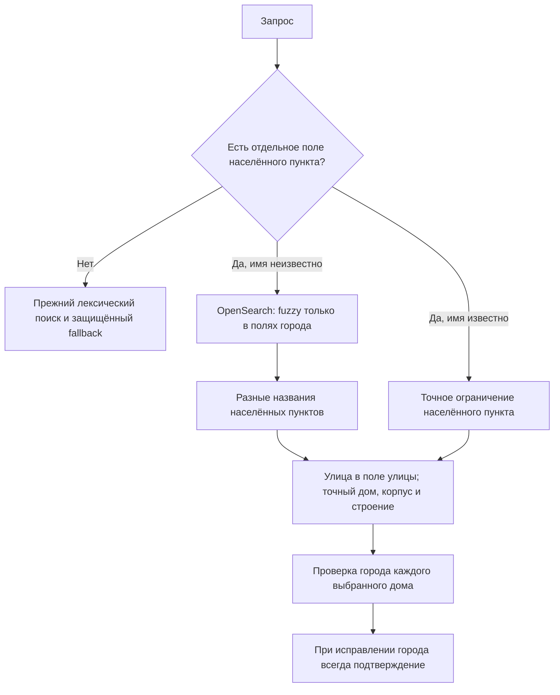

Лабораторный цикл 9 ноября 2026 года продолжает [проверку населённых пунктов](search-locality-guard.md).
Рабочий API на Германии читает PostgreSQL; новый профиль OpenSearch пока не включён.
README разделяет эти два окружения. Master, prod и тег выпуска не меняются.

## Что сравнивается

Прежний `locality.scoped-AUTO-r1.0` ограничивает явно указанный населённый пункт,
но не отделяет его опечатку от опечатки улицы. Новый `locality.roles-sources-AUTO-r1.0`
добавляет отдельное поле города к исходным вариантам адреса. Предыдущие поля,
анализаторы, BM25 `b=0.2` и все документы сохранены: меняются роли полей и решение
об уточнении, а не словарь правильных ответов.

OpenSearch исправляет написание названия и ранжирует улицы. Python определяет структурную
границу полей и проверяет идентичность результата. Пользовательского словаря «ошибка → город» нет.
Признаком поля служат обозначение населённого пункта либо первая часть перед запятой
при отдельном обозначенном поле улицы. Например, «Тестогад, улица Учебная, дом 4»
отличается от «Учебный, проезд 4к1»: во втором случае после типа нет отдельного имени улицы.
Площадь, числовой микрорайон, рабочий посёлок и посёлок городского типа проверяются отдельно.
При неоднозначной границе весь запрос остаётся прежнему поиску.

Названия группируются по полному значению `keyword`, а не по первым улицам в выдаче.
Поэтому населённый пункт с большим числом улиц не занимает весь бюджет кандидатов.
Используются отдельные поля канонического и исходного города; `fielddata` не включается.
Это соответствует [модели multi-fields](https://docs.opensearch.org/latest/field-types/mapping-parameters/fields/)
и [агрегациям OpenSearch](https://docs.opensearch.org/latest/aggregations/).
Ограничение — по 64 названия в каждой из двух групп агрегации; усечение отмечается в результате.
Частичный ответ по ошибке шарда или таймауту не считается пустой успешной выдачей.

Из токенов всего запроса вычитаются только токены поля города, с учётом повторений.
Оставшиеся слова и числовое имя микрорайона должны присутствовать в поле улицы.
Город не заменяется названием похожей улицы. Корпус, строение и номер дома не исправляются fuzzy.
Неизвестное написание города требует подтверждения даже при одном подходящем доме;
v1 не может обойти это подтверждение и автоматически отправить код.

## Неполные имена и коды

При совпадении хотя бы одного идентификатора дома с выдачей каталога сохраняются
его дополнительные исходные варианты с кодами. Это отдельные кнопки выбора,
а не объединение неподтверждённых записей в один дом. Итог повторно ограничивается городом.
Размер списка ограничен; усечение отмечается явно.

Если точное название распознано каталогом без кодов, похожая улица с кодами не выбирается
автоматически. Требуется уточнение. Строка, где другой город указан в поле адреса,
не становится тем же домом только из-за примечания в названии улицы.

## Данные и проверка

Исходная база и каталог неизменны. Новый индекс содержит те же 19 300 корневых документов
и 131 176 документов с вложенными вариантами. После удаления добавленного поля исходные
документы побайтно совпадают в каноническом JSON. Размер вырос с 38 918 196 до 41 327 886 байт.
Это размер индекса, не память процесса JVM.

Из сохранённых переписок выделены семь узких гипотез исправления названия города:
тот же пользователь изменил одно слово при том же доме. Это гипотезы, не подтверждённое
намерение. Семь старых ссылок на сообщения из пула исправлений не разобрались;
они пропущены явно, а не объявлены отрицательными примерами.

Отдельные проверки включают:

- 18 производных случаев: ошибочное и правильное поле города, отрицательные роли и уточнение улицы;
- 12 ограничений из разбора регрессий: один адрес с кодами, семь известных домов без кодов
  и четыре запроса, в которых прежняя выдача подменяла название посёлка;
- 228 синтетических опечаток для 121 хранимого названия населённого пункта: одна замена буквы,
  две для достаточно длинного слова; совпадения с известным названием исключены;
- 22 прежних расхождения кодов при неполном названии источника.

Синтетические случаи выбирались по хранимым адресам, встречающимся в истории, до просмотра
результатов нового профиля. Это отдельный стресс-тест, не 228 новых пользовательских ошибок.
Маленький пилот на 592 записях прошёл без конфликтов нового профиля и ошибок движка.

Первый полный прототип не прошёл: потерял один прежний адрес и семь известных домов без кодов.
Причины — неверная граница поля и представление посёлка после родительского города в ГАР.
Ошибки исправлялись до повторного полного сравнения; первый результат сохранён для проверки.
Четыре старых ответа о доме без кодов, напротив, принадлежали другому населённому пункту;
их возврат не считается целью совместимости.

## Полный результат

Повторный полный прогон содержит 48 115 записей и 96 230 ответов двух вариантов:
44 083 исторических, 2 528 гипотез исправления, 563 размеченных контроля и
941 дополнительный запрос из аудита населённых пунктов. Все восемь частей проверены
по исходникам, снимкам индекса и входным SHA-256; пропусков и повторов нет.
Прежний контрольный профиль на первых 47 857 записях дал в точности те же полные результаты,
что до добавления полей города. Ошибок движка нет.

| Проверка | Прежний `scoped` | Отдельные поля города и исходные варианты |
|---|---:|---:|
| Прежняя подсказка доступна / 44 083 | 44 002 | 44 002 |
| Гипотеза исправления доступна / 2 528 | 1 616 | 1 616 |
| Нарушения 563 контрольных условий | 240 | 0 |
| Синтетическая опечатка: нужный адрес предложен / 228 | 225 | 228 |
| Из них с обязательным подтверждением / 228 | 0 | 228 |
| Полный набор кодов v1 доступен / 43 969 | 43 962 | 43 962 |

240 нарушений старого профиля — **не 240 доказанных неправильных адресов**:
228 относятся к требованию подтверждать изменённый город. Проверка номера дома,
буквы, корпуса и строения действует отдельно. Сумма подсказок не увеличилась:
изменились безопасность выбора и полнота доступных исходных кодовых вариантов.

Сверка самих кодов использует 41 918 разных исторических текстов и уникальные тройки
«подъезд, источник, код». По сравнению с прежним native дополнительные коды доступны
в 22 записях, в одной исключён неподтверждённый исходный вариант с противоречивым городом.
По сравнению с каталогом PostgreSQL — три приобретения и одно такое исключение.
Это доступность через меню, не отправка всех кодов сразу. Семь отличий от v1 остались прежними
и разобраны в [предыдущем отчёте](search-locality-guard.md#почему-семь-отличий-от-v1-не-означают-семь-потерянных-правильных-ответов).

Сохранены все восемь дополнительных контролей прежнего дома, включая семь домов без кодов.
Четыре подмены названия посёлка отклонены. Ещё один запрос только с посёлком и номером дома
без улицы больше не выбирает улицу из примечания исходной записи; правильный дом для него
не установлен. Не следует объявлять этот отказ найденным правильным ответом.

Локально прошли 772 теста с настоящим PostgreSQL, один платформенный тест пропущен;
Ruff и проверка форматирования прошли. [Агрегаты и контрольные суммы](../../../../search-city-roles.summary.json)
не содержат переписок, пользовательских идентификаторов или кодов. Полные строки остаются
в игнорируемом `artifacts/private`.

## Границы вывода

Аудит использует сохранённый снимок 2 282 диалогов и 84 488 входящих текстов от 6 ноября МСК,
а не новую выгрузку на дату отчёта. Корпус использован при разработке и не является слепым тестом.
Старый ответ проверяет совместимость, но сам по себе не доказывает правильность адреса.

Fuzzy-проверка городов этого профиля работает по индексу улиц с кодами, а не по всем
населённым пунктам ГАР. Верно написанный дом без кодов по-прежнему ищется в полном каталоге;
для любой возможной опечатки города без кодов полнота не обещается.

Новый профиль не решает размещение JVM на маленьких VDS. Предыдущая
[проверка ресурсов](search-coverage.md#размер-и-память) не прошла; ни VPN, ни другие службы
не отключались ради OpenSearch. Включение native и выпуск v2 остаются отдельными решениями.

Следующая [проверка привязок и ресурсов](search-binding-resources.md) отделяет
исторические типы населённых пунктов от противоречий источника и показывает,
что проверенный профиль не помещается на текущей Германии с запасом памяти.
