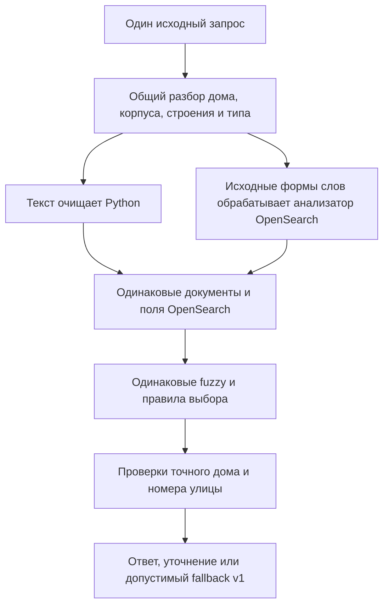

Продолжение [сравнения стратегий](search-experiments.md), задача [#10](https://github.com/omkality/domofomka/issues/10).
Это лабораторные варианты для dev. Рабочий выбор движка не меняется; выпуск в master и prod приостановлен.

## Что сравниваем

Отделяем четыре причины изменения ответа: словарь форм, обработку символов, текстовое ранжирование
и правила выбора адреса. Больше найденных ответов само по себе не означает более правильный поиск.

Ветка с анализатором получает исходное написание порядковых слов: например, «восьмая», а не уже готовое `8`.
Проверки используют реальные токены `_analyze`, включая получившийся номер улицы. Дом и его части
пока разбираются общим кодом. Поэтому эксперимент проверяет перенос **лексической обработки**,
а не доказывает возможность удалить весь Python-разбор адреса.

Индекс содержит 1 076 095 документов улиц и 111 876 вложенных алиасов с привязкой к дому.
Каталог и индекс сверяются по SHA-256. Настройки индекса, токены, входы, зависимости и точные исходники
сохраняются перед прогоном; изменение исходников или анализаторов во время него запрещено.
Продолжение допускается только для целых групп ответов с теми же байтами зависимостей и входами.
Частные данные остаются в игнорируемой `artifacts/private`.

## Почему прежний ответ — слабый эталон

На 2 031 расхождении текущего каталога и самостоятельного OpenSearch получены категории:

| Категория | Запросов |
| --- | ---: |
| OpenSearch выбрал один из уже предлагавшихся каталогом вариантов | 1 695 |
| Новый автоматический кандидат | 196 |
| На актуальном коде ответы совпали | 92 |
| Другая улица или адрес | 7 |
| Историческая подсказка противоречит номеру дома | 10 |
| Другое состояние или набор вариантов | 31 |

Это классификация расхождений, а не разметка правильности. Выбор одного варианта может убрать лишнее
уточнение, но может и скрыть другую подходящую улицу. Совпадение буквального адреса ещё не подтверждает
физический дубль: для объединения нужны достоверные идентификаторы и происхождение данных.
В 1 239 из 1 695 случаев выбора готового варианта текст названия улицы у всех альтернатив совпадает
после приведения регистра и ё/е. Но в 1 491 случае есть хотя бы один адрес без ГАР-ID,
а в 291 — несколько разных заполненных ГАР-ID. Эти группы могут пересекаться.
Сокращение меню не считается доказанным исправлением дублей.

Контекст десяти противоречивых подсказок показал шесть серий быстрых запросов, три изменения корпуса
и один случай с неустановленной причиной. Старое правило «последнее входящее → следующий ответ»
в таких диалогах не устанавливает намерение. Эти подсказки нельзя использовать как достоверные цели.

В ручной проверке разделены:

- **Ограничения исходного запроса**: должны выполняться для каждого предложенного адреса.
- **Позднейшее уточнение пользователя**: адрес должен присутствовать среди вариантов; остальные
  допустимые варианты не становятся ошибочными задним числом.
- **Неустановленное намерение**: отсутствие города или смена улицы не заполняются догадкой.

## Полный лексический прогон

46 908 случаев: 44 083 исторических запроса, 2 528 гипотез исправления и 297 размеченных ограничений.
«Сохранено» означает присутствие прежней подсказки, включая меню. Это **не точность поиска**.

| Профиль | Исторические подсказки | Гипотезы исправления |
| --- | ---: | ---: |
| Рабочий каталог | 44 005 | 1 388 |
| Анализатор OpenSearch, AUTO, верхняя группа | 43 867 | 1 565 |
| Каталог с экспериментальным приоритетом полного имени | 43 966 | 1 368 |
| Python, тот же приоритет полного имени | 43 910 | 1 544 |
| Анализатор OpenSearch, тот же приоритет полного имени | 43 910 | 1 549 |

У всех пяти вариантов нет конфликтов на этих 297 ограничениях и нет HTTP-отказов.
Приоритет полного имени не оказался универсальным улучшением и в рабочий каталог не включён.

Два последних профиля дали одинаковый ответ в 46 903 из 46 908 случаев. Все пять различий связаны
с латинской `ë` внутри русского слова: прежняя очистка Python разделяет слово, Unicode-токенизация
OpenSearch сохраняет его для fuzzy. Это конкретный дефект обработки символов, а не доказательство
превосходства одного ранжирования. Для следующего сравнения добавлен отдельный Python-профиль,
сохраняющий Unicode-буквы; рабочая очистка по умолчанию пока не меняется.

## Порядковые числа: одинаковый словарь

102 контролируемые записи получены из 17 подтверждённых ГАР-идентичностей с кодами.
Проверяются цифровые формы, падежи, род и составные порядковые числа. Ожидаемый дом и идентичность
взяты из данных до запуска поиска, а не из ответа проверяемого нормализатора.

| Словарь | Python → OpenSearch | Анализатор OpenSearch |
| --- | ---: | ---: |
| Общие формы прежнего Python-разбора | 74/102 | 74/102 |
| Одинаковый расширенный словарь | 102/102 | 102/102 |

28 дополнительных ответов объясняются расширением словаря. Они не доказывают преимущество движка.
На 3 110 уникальных по паре диалог/текст реальных запросах с порядковыми числами все четыре
варианта из таблицы дали одинаковые полные ответы. У 739 запросов нет даже исторической подсказки;
равенство ответов не объявляется их правильностью. Расширенные формы из синтетической проверки
не дали дополнительного выигрыша именно на этой реальной выборке.
Города и порядковые формы объединены в одном поисковом `synonym_graph`; stemming проверяется отдельно.
Синонимы здесь используются при поиске, не меняя хранимые адреса.
Особенности многословных синонимов описаны в [документации OpenSearch](https://docs.opensearch.org/latest/analyzers/token-filters/synonym-graph/).

## Ограничения fuzzy: отдельный эксперимент

Числовой номер улицы не должен заменять её буквенное имя. Совпадение города тоже не заменяет улицу.
В экспериментальном запросе полное покрытие слов проверяется фильтром, а буквенные слова —
отдельным совпадением поля улицы. Цифровая улица остаётся допустимой при точном совпадении города.

Ещё один отрицательный сценарий: точная улица существует, а запрошенный дом в каталоге неизвестен.
Нельзя молча перейти на похожую улицу с нужным номером дома. Такой переход ограничен и для fallback v1;
допустим только прежний ответ с тем же полным именем и типом. Если дома нет в каталоге, нельзя утверждать,
что его нет в действительности.

На 37 вручную проверенных случаях, включая 25 уточнений с наблюдаемой улицей и домом:

| Вариант | Улица и дом из уточнения с кодами предложены, из 25 | Конфликт исходных ограничений, из 37 | Другой автоматический адрес относительно уточнения |
| --- | ---: | ---: | ---: |
| Рабочий каталог | 0 | 2 | 7 |
| OpenSearch с приоритетом полного имени | 24 | 2 | 1 |
| OpenSearch с проверкой роли улицы и известного имени | 24 | 0 | 0 |

При одинаковом расширенном словаре Python и анализатор дали одинаковые значения этой таблицы.
Выборка специально составлена из сложных расхождений и **не представляет средний поток пользователей**.
Город, которого нет в разметке, эта проверка не подтверждает.
Один пропуск остаётся: точное имя из ошибочного запроса существует в другом месте, и консервативное
правило блокирует переход к предполагаемому исправлению. Это компромисс, требующий отдельной проверки.

Полный повтор с одинаковым расширенным словарём и этими ограничениями завершён на 46 908 случаях:

| Профиль | Исторические подсказки, из 44 083 | Гипотезы исправления, из 2 528 |
| --- | ---: | ---: |
| Рабочий каталог | 44 005 | 1 388 |
| Python → OpenSearch с ограничениями | 43 890 | 1 455 |
| Анализатор OpenSearch с теми же ограничениями | 43 890 | 1 455 |

У двух экспериментальных вариантов совпали **все 46 908 последовательностей токенов и все 46 908 ответов**.
Это подтверждает эквивалентность лексической обработки на проверенном корпусе, а не всех возможных строках.
Относительно каталога каждый вариант восстановил 157 подсказок и потерял 205; это изменения слабых
исторических ориентиров, не число истинных исправлений и ошибок. На 297 размеченных ограничениях
конфликтов нет, HTTP-отказов нет. Один многоадресный запрос остановлен ограничением числа токенов.
В 388 запросах сработало ограничение перехода с известного полного имени на другую улицу.
Такая политика пока не подходит для автоматического переключения рабочего поиска.

Разбор потерь полного прогона также выявил отдельные классы, которые нельзя скрыть общей метрикой:

- Частичное официальное имя: пользователь пропускает «Маршала», «Бориса» или «Архитектора».
  Жёсткое полное имя может запретить полезный вариант из текущего каталога.
- Административные префиксы в неподтверждённых ID: короткое имя населённого пункта может выбрать
  ГАР-адрес без кодов, исключив исходную формулировку с кодами. Это ещё не основание объединять ID.
- Разрыв одного слова на два и более двух ошибок в длинном слове: обычный fuzzy по отдельным токенам
  не восстанавливает все такие запросы.
- Название, совпадающее со служебным словом, например «Набережная»: общий разбор может оставить
  пустой текст. Лабораторный native возвращает `incomplete_query`, и прежний fallback, запускаемый
  только на `not_found`, не вызывается. До выбора native этот сценарий необходимо исправить и проверить.

Стоимость запроса также ограничивается: 500 символов, 24 анализированных токена и расчётный бюджет
расширений `min(50, floor(768 / (4 × токены)))`. Лимит Lucene не увеличивается.
Это ограничение экспериментального построителя, а не доказательство ресурсоёмкости постоянного сервиса
на маленьком VDS. HTTP-отказ считается отдельно от `not_found`.

## Новая временная выборка

Настройки зафиксированы до просмотра 147 входящих текстов из 46 новых диалоговых выгрузок.
142 адресных запроса получили ручную разметку исходных улиц, домов и явно указанных городов
до просмотра ответов поиска. В остальных пяти сообщениях — запуск или неадресный ввод.

У каталога и трёх сравниваемых профилей нет конфликтов на 142 ограничениях. В каждом варианте
118 ответов с кодами, 13 меню уточнения и 3 определённых адреса без кодов. Эти числа не подтверждают
неуказанный город и не измеряют универсальную точность. После просмотра эта выборка больше
не используется как независимая для дальнейшей подгонки.

## Состояние dev на момент лексического цикла

Этот раздел фиксирует состояние до последующих исправлений названий и границ полей.
Актуальные изменения и проверки описаны в [продолжении](search-name-identity.md).

Рабочие PostgreSQL-каталог, legacy v1 и выбор поисковой стратегии не переключены.
Опциональные параметры нормализатора нужны лаборатории. На всех 84 488 текстах исходного экспорта
ответ структуры разбора по умолчанию совпал с предыдущей версией: ноль различий; при сохранении
исходных порядковых форм также не изменились дом, подъезд, тип и нормализованные слова.

Постоянный OpenSearch на Германии и Финляндии не установлен. Локальная лаборатория имеет лимит
3 ГиБ и heap 1 ГиБ; в ней несколько индексов. Её задержки и память не считаются измерением
минимального эксплуатационного размещения. Хранилище одного текущего индекса занимает
561 247 678 байт (около 535 МиБ); это диск индекса, без JVM, каталога PostgreSQL и образов.
До размещения на существующем VDS необходим отдельный замер полного бюджета. Выбор движка остаётся открытым.

Следующие условия выпуска: разбор оставшихся потерь и неоднозначностей, проверка отрицательных
сценариев с корпусами и буквами, измерение ресурсов выбранного варианта и приёмка только на dev.

[Агрегаты этого цикла](../../../../search-lexical-summary.json) не содержат переписок или кодов домофонов.
Профили и анализаторы заданы в `tools/experiments/search_lexical_profiles.py`, построитель запросов —
в `tools/experiments/benchmark_native_search.py`, оценка контекста — в `tools/evaluation/review_search_differences.py`.

Продолжение: [сравнение BM25 и boolean внутри OpenSearch](search-scoring-review.md).
